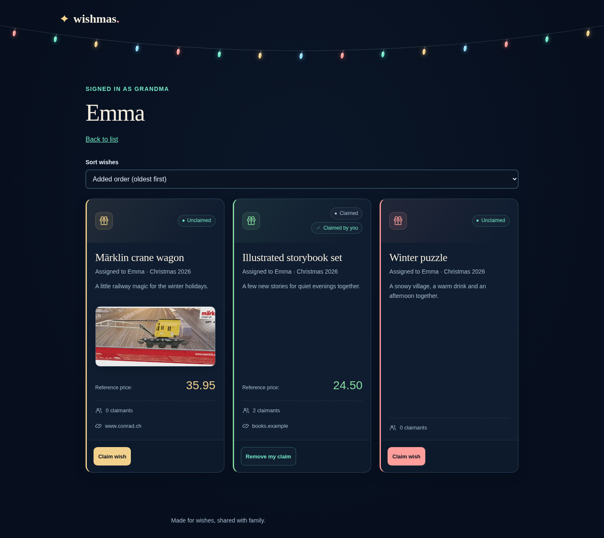
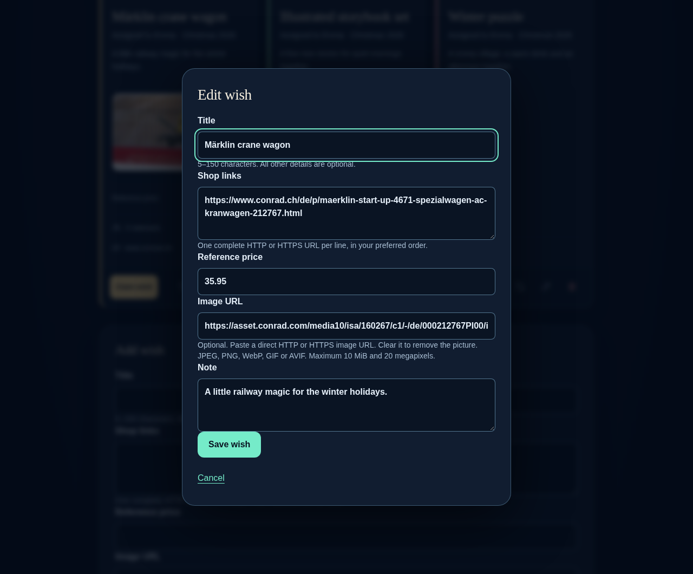
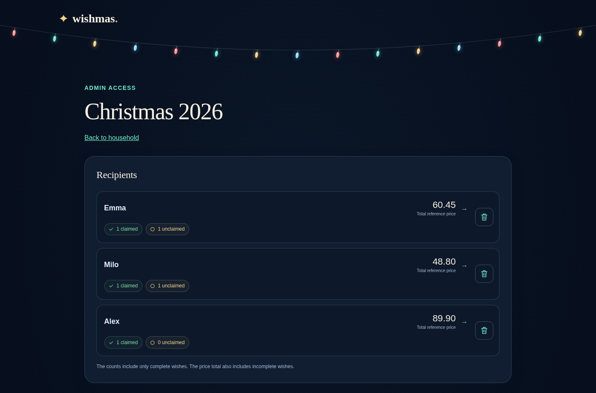
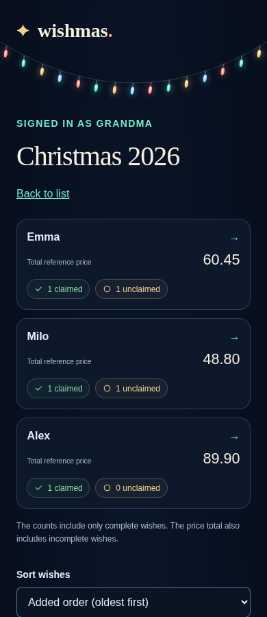
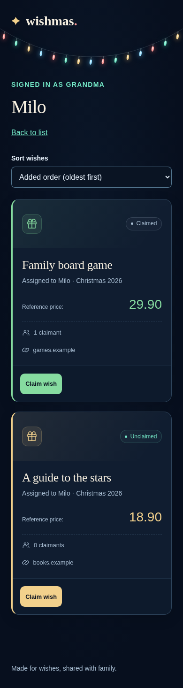

# Wishmas

[](https://github.com/pheelee/wishmas/releases/latest)
[](https://github.com/pheelee/wishmas/blob/badges/coverage.md)
[](https://github.com/pheelee/wishmas/pkgs/container/wishmas)

A self-hosted family wishlist app with a dark December-night theme, colorful Christmas lights and gentle snowfall. Built with Go, Tailwind CSS and vanilla JavaScript.

## Screenshots

An example household with fictional wishes and gift-givers. Select an image to see it at full size.

### Wishes and claims

Pictures, reference prices, shop links and colored wish states. Gift-givers recognize their own claims without seeing other claimants’ names.

[](docs/screenshots/wishlist-desktop.png)

<table>
  <tr>
    <th>Setup and appearance</th>
    <th>Edit a wish</th>
  </tr>
  <tr>
    <td valign="top"><a href="docs/screenshots/setup-desktop.png"></a></td>
    <td valign="top"><a href="docs/screenshots/edit-wish.png"></a></td>
  </tr>
</table>

### Manage recipients

Parents choose recipients and see reference totals and claim counts for each list.

[](docs/screenshots/manage-recipients.png)

<table>
  <tr>
    <th>Mobile overview</th>
    <th>Mobile wishlist</th>
  </tr>
  <tr>
    <td valign="top"><a href="docs/screenshots/overview-mobile.png"></a></td>
    <td valign="top"><a href="docs/screenshots/wishlist-mobile.png"></a></td>
  </tr>
</table>

## Features

- Create lists for different occasions and choose their recipients from your household.
- Keep wishes in a shared household pool, then assign them to a recipient and list.
- Add optional pictures, multiple shop links, a reference price and notes.
- Share individual links with gift-givers. They can claim wishes without creating accounts; parents manage everything with a shared password.
- See recipient totals and claimed/unclaimed counts. Gift-givers see their own claims and claim counts; parents can see all claimant names.
- Use English or Swiss German, with a responsive layout for desktop and mobile.
- Store household data in YAML locally or in S3-compatible storage. Pictures stay on disk.

## Run with Docker Compose

Use an existing Traefik installation configured for HTTPS and HTTP-to-HTTPS redirection. Wishmas runs behind the proxy; its backend port stays private.

Create a `.env` file with your domain, existing Traefik network, certificate resolver and the actual Traefik peer IP or restricted CIDR. Replace these example values:

```dotenv
WISHMAS_HOST=wishmas.example.com
TRAEFIK_NETWORK=your-traefik-network
TRAEFIK_CERT_RESOLVER=your-certificate-resolver
WISHMAS_TRUSTED_PROXIES=your-traefik-ip/32
```

Save this as `compose.yaml`:

```yaml
services:
  wishmas:
    image: ghcr.io/pheelee/wishmas:latest
    restart: unless-stopped
    environment:
      WISHMAS_TRUSTED_PROXIES: "${WISHMAS_TRUSTED_PROXIES:?Set WISHMAS_TRUSTED_PROXIES}"
    volumes:
      - wishmas-data:/data
    networks:
      - proxy
    labels:
      traefik.enable: "true"
      traefik.docker.network: "${TRAEFIK_NETWORK:?Set TRAEFIK_NETWORK}"
      traefik.http.routers.wishmas.rule: "Host(`${WISHMAS_HOST:?Set WISHMAS_HOST}`)"
      traefik.http.routers.wishmas.entrypoints: "${TRAEFIK_ENTRYPOINT:-websecure}"
      traefik.http.routers.wishmas.tls: "true"
      traefik.http.routers.wishmas.tls.certresolver: "${TRAEFIK_CERT_RESOLVER:?Set TRAEFIK_CERT_RESOLVER}"
      traefik.http.services.wishmas.loadbalancer.server.port: "8080"

volumes:
  wishmas-data:

networks:
  proxy:
    external: true
    name: "${TRAEFIK_NETWORK:?Set TRAEFIK_NETWORK}"
```

If your HTTPS entrypoint has another name, set `TRAEFIK_ENTRYPOINT` in `.env`. Run one Wishmas instance per household data volume.

```sh
docker compose up -d
```

Open `https://your-domain` and complete the setup wizard to choose your household name, admin password, language and appearance. Then add recipients, gift-givers, lists and wishes.

The image runs as UID/GID `1000:1000`. Keep `/data` across container replacements, including when using S3. For custom UID/GID or bind mounts, use the [Compose reference](docker-compose.yml) and make the mounted directory writable by the selected user. See [S3 configuration](docs/s3-storage.md) and [password administration](docs/offline-admin.md) for those options.

### Build from source

Clone this repository and build the image locally before starting the same Compose configuration:

```sh
git clone https://github.com/pheelee/wishmas.git
cd wishmas
docker build -t ghcr.io/pheelee/wishmas:latest .
```

## Environment variables

These variables are read by the application. No external credentials are needed for the default local backend.

| Variable | Default | Purpose |
| --- | --- | --- |
| `WISHMAS_ADDR` | `:8080` | HTTP listen address. Also used by `wishmas healthcheck`; wildcard binds are probed through loopback. |
| `WISHMAS_DATA_DIR` | `data` (`/data` in the image) | Persistent writable directory for YAML, pictures, offline cache and pending retry records. Required even with S3. |
| `WISHMAS_TRUSTED_PROXIES` | empty | Comma-separated trusted proxy IPs/CIDRs. Configure the actual HTTPS proxy peers; no proxy is trusted by default. |
| `WISHMAS_STORAGE` | `local` | YAML backend: `local` or `s3`. |
| `WISHMAS_S3_ENDPOINT` | none | Required with `s3`: HTTP(S) endpoint without credentials, query or fragment. Use HTTPS for remote services. |
| `WISHMAS_S3_BUCKET` | none | Required with `s3`: existing bucket. The application does not create it. |
| `WISHMAS_S3_REGION` | `us-east-1` | S3 signing region. |
| `WISHMAS_S3_ACCESS_KEY_ID` | none | Required with `s3`: access key supplied securely. |
| `WISHMAS_S3_SECRET_ACCESS_KEY` | none | Required with `s3`: secret key supplied securely. |
| `WISHMAS_S3_SESSION_TOKEN` | empty | Optional temporary-credential session token. |
| `WISHMAS_S3_TIMEOUT` | `5s` | Positive Go duration for each S3 operation, for example `10s`. |

S3 uses these explicit credentials and region, without ambient AWS credential discovery. S3 variables are ignored in local mode. Keep secrets outside version control. See [S3 configuration](docs/s3-storage.md) for permissions and outage behavior.

Compose-only settings are not read by the binary: `WISHMAS_HOST`, `TRAEFIK_NETWORK`, `TRAEFIK_CERT_RESOLVER` and optional `TRAEFIK_ENTRYPOINT` (`websecure`) configure the README's proxy example. `WISHMAS_UID` and `WISHMAS_GID` (both `1000`) configure the user in the repository's Compose reference. That reference fixes the application address to `:8080` and data directory to `/data`; edit its service environment to override them. Development/test variables are not production configuration.

## Healthcheck and logs

The scratch image runs `/wishmas healthcheck` directly, without a shell or curl, every 30 seconds (six-second Docker timeout, ten-second start period, three retries). You can also run it manually with `docker compose exec wishmas /wishmas healthcheck`.

The command performs a direct HTTP request to `/healthz` on `WISHMAS_ADDR`, with a five-second timeout, no proxy and no redirects. It exits quietly with status 0 only for HTTP 200; failures print a diagnostic and exit nonzero. `/healthz` supports GET and HEAD and checks server liveness only. It does not read household data or contact S3, so a supported S3 outage does not mark the process unhealthy. It does not establish write readiness or validate proxy HTTPS configuration.

Application logs go to stderr and are available through `docker compose logs wishmas`. They include image download starts/results, confirmed household saves, completed mutation actions, request failures and background recovery/retry errors. Ordinary successful reads and health probes are quiet. Logs omit passwords, cookies, share codes, household content and full image URLs; error categories are recorded instead of potentially sensitive raw provider responses.
