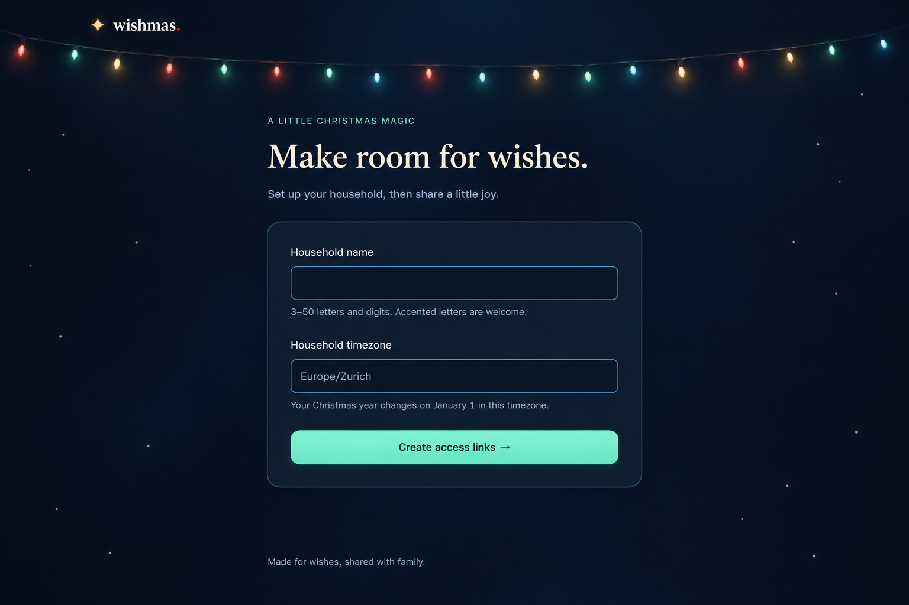

# Approved December-night design

Status: original appearance baseline approved and implemented. Later user-approved UI polish supersedes the original motion/control and layout criteria below; current requirements are authoritative in [CON-003](../../sdd/constraints.md).

## Requested direction

The user requested a cold, dark December-night theme, colorful Christmas-bulb accents, and unobtrusive snowfall. They approved the selected visual direction and its observable implementation criteria before code changes.

## Approved appearance

- Almost-black midnight navy background, a slightly lighter navy form card, and restrained ice-blue borders.
- Soft-white text and ivory serif headings, with readable cool-gray helper text.
- A fine string of small coral, gold, mint, and ice-blue Christmas bulbs near the header; localized glow without flashing.
- Muted mint/teal primary action, retaining the current setup layout and fields.
- Sparse, tiny snow particles in empty background margins, leaving the form and text clear.

## Original approved motion direction (superseded)

The mockup is static and cannot demonstrate animation. The user approved sparse, slow, faint falling particles behind the content, pause/resume with browser persistence, and no animation when reduced motion is enabled. The approved limits are recorded in CON-003-AC3/AC4. No animation library has been added.

## Implemented scope

The approved palette, bulb brightness, and atmosphere are applied to setup, access-link screens, and error pages. Existing setup functionality and form fields are retained. The running app demonstrates the snowfall; the baseline image itself is static.

## Original approved implementation criteria (superseded)

These criteria are now recorded in the specification as CON-003-AC1 through CON-003-AC5.

1. All existing screens use the approved dark navy surfaces, ivory/soft-white text, ice-blue borders, and mint primary actions. No light-background card or input remains.
2. The header shows a restrained strand of coral, gold, mint, and ice-blue bulbs with steady glow and no flashing.
3. Decorative snow is limited to 16 particles, 1–3 pixels each, at no more than 35% opacity, with downward journeys lasting 20–40 seconds. Snow stays behind content, does not cross the form or text, and never intercepts clicks or keyboard focus.
4. A keyboard-accessible “Pause snow” / “Resume snow” control is available. The selection is remembered in the browser. With reduced motion enabled in the browser, snow does not animate.
5. Desktop and mobile previews retain readable labels and controls, with no horizontal overflow; the existing setup, copy-link, regeneration, and stale-page tests continue to pass.

Snowfall is implemented with CSS particles and vanilla JavaScript controls, without an animation library. Automated checks verify motion, keyboard pause, remembered preference, reduced-motion behavior, and responsive layouts. Generated pixels serve as an approved design reference and are not used as the rendered UI.

## Current approved UI polish

The same dark palette and steady bulb colors remain. Bulbs default to 120% of the original size. Setup sliders preview bulb size (80–200%, inverse bulb count), snow size (50–200%), and snow amount (8–48), saved household-wide in YAML. Snow is always present without pause/resume; reduced motion displays static snow. Wider pages, individual wish cards, icon actions, and modal editing are implemented and verified by browser scenarios. Creation forms remain inline. The baseline image remains a historical visual reference, not a current screenshot.

## Generation

Built-in image generation, using the existing setup screenshot as a layout and copy reference. Generated pixels are a design suggestion, not production UI assets or evidence of an implemented animation.

### Prompt

Use case: ui-mockup. Create one polished high fidelity desktop UI visual suggestion for this existing Wishmas Christmas wishlist app. The supplied screenshot is a reference for the actual existing layout, exact copy and controls. Restyle it as a cold dark December night. Preserve the existing screen's header brand wishmas., central single-column heading and setup form with just Household name and Household timezone, Create access links button, helper copy and footer. Do not add product features or navigation. Background almost black deep midnight navy #070F1E with a very subtle cool blue atmospheric gradient; raised form panel #111D30, dark navy input fields, restrained ice-blue borders, bright readable soft-white text and muted cool-gray helper text. Warm ivory serif display headline contrasted with clean sans serif labels. Existing central hierarchy and generous empty margins retained. Add a fine understated curved string of small Christmas tree light bulbs just beneath the header across the upper background: tiny coral red, soft gold, mint green and icy blue glowing bulbs with tight soft halos, not neon, no blinking depicted. Primary action muted luminous mint/teal with dark text; small warm gold decorative star at logo. Suggest gentle snowfall with ONLY a dozen tiny sparse low-opacity off-white specks scattered in the outer empty margins, no large flakes, none on the form/text, no snow piles. No snowflake icons or storm. This should feel intimate, premium, quiet, cold winter night lit by Christmas bulbs. Pixel-sharp plausible implementable web UI, not painterly or 3D. Entire screen with header and footer visible, landscape 1536x1024 composition. Text exact same as screenshot including 'Make room for wishes.' and 'A LITTLE CHRISTMAS MAGIC'. A static concept only, no device mockup, no design-board annotations, no extra headings, no palettes drawn onto the UI.
