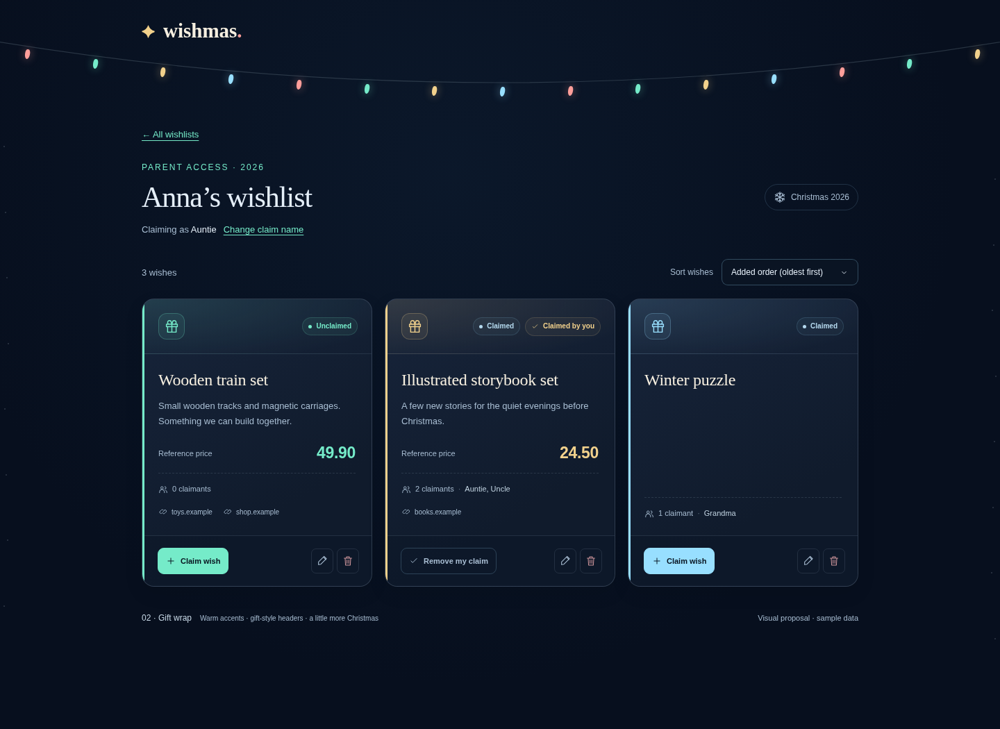

# Selected Gift-wrap card direction

The user selected proposal 2, Gift wrap. The approved WSH-005 acceptance criteria are implemented and verified. This records the selected visual reference.

The card treatment uses colored edges and subtle header gradients, gift icons, serif titles, claimed/unclaimed and claimed-by-you badges, prominent optional reference prices, quiet domain links, and a separated action footer. Existing claim actions and parent-only management remain available.

Only card presentation is selected. Surrounding sample-page chrome and fictional sample wishes are comparison context. Numeric prices retain no currency. Current permission, sorting, optional-field, modal, and claim rules remain authoritative.

The temporary design alternatives and proposal generator were removed after implementation at the user’s request. The selected reference above is retained.
